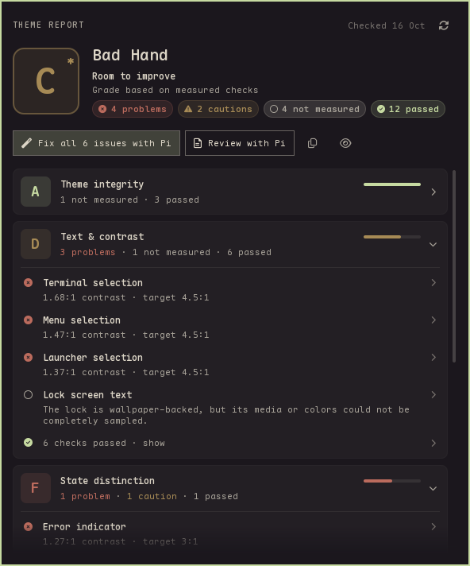

# Theme Report

A read-only health check for Omarchy themes. A bar badge shows your current theme's grade. Click it for a report card that shows the measurements behind every finding.



## What it checks

| Area | What it measures |
| --- | --- |
| Theme integrity | `colors.toml` parses, the four core colors resolve, shell values are in range, wallpapers decode |
| Text & contrast | Text against its background in the terminal, bar, popups, notifications, menus, launcher, polkit dialog, lock screen and tooltips |
| State distinction | Accent, error and selection colors stand apart from the base colors |
| Shell surfaces | Selected and focused fills, and popup borders, are visible |
| Wallpaper resilience | Lock screen and launcher text over your theme's own wallpapers, sampled |

It does **not** judge taste, count optional files, or grade how polished a theme is for publishing. An A means the theme passed these checks. It is not an accessibility certification.

## Reading the badge

| Badge | Meaning |
| --- | --- |
| `A`–`F` | Grade from the last check |
| `B*` | Provisional: some checks could not be measured (the panel says which) |
| `~B` | You have switched themes since this result; open the panel to check the new one |
| `?` | No result yet |

The panel checks your theme when you open it. Click the Refresh icon (or press R) to force a fresh check. Nothing runs in the background unless you install the optional theme-switch hook.

The top of the panel shows the overall grade and a count of problems. Below that, each area has a card with its own grade. Cards for areas that need work open on their own and list their problems. Click a card to open or close it, and click a check to see color previews, the contrast against its target, sampled wallpaper grids, the files and keys involved, and what to change.

## Fix it with your agent

When the report finds problems, the panel offers **Fix all N issues with &lt;agent&gt;**, using the agent you chose with `omarchy default agent`. The agent opens in a new terminal window with a prompt built from the measurements: the failing checks, their targets, and the `colors.toml` and `shell.toml` keys behind them. An expanded check offers the same for that check alone. **Copy prompt** and **Preview** show or copy the text without launching anything.

Omarchy starts agents without permission prompts, so the prompt sets the limits. The agent:
- edits only the theme's source files: on a new git branch when the theme is in a git repository, otherwise in a `<name>-tuned` copy (stock themes are always copied);
- never touches wallpapers or the applied theme;
- treats the theme's files as data, follows no instructions and runs no commands found in them, and stays off the network;
- states its plan before editing, and asks before applying the result.

The agent checks its work with `theme-report audit`. If nothing needs fixing but some checks could not be measured, the button asks the agent about those instead.

**Review with &lt;agent&gt;** asks the agent for a read-only review that goes beyond the measured checks. It's offered for every theme, including ones that pass. The agent saves a Markdown write-up, and the panel shows it as an **Agent review** card at the top. The card is marked out of date once the theme changes.

Prompts work as they are. For more detail on reading the report and making safe edits, install the optional `theme-report` agent skill with `bash scripts/install.sh --with-skill`.

## Install

Theme Report has two parts: the bar widget in this repository, and the `theme-report` analyzer that does the measuring. You can build the analyzer from source with Rust 1.88 or newer, or use the prebuilt x86_64 binary from the [latest release](https://github.com/OldJobobo/theme-report/releases/latest). Nothing needs root.

**With Omarchy's plugin manager:**

```sh
omarchy plugin add https://github.com/OldJobobo/theme-report.git
cd ~/.config/omarchy/plugins/oldjobobo.theme-report
export CARGO_TARGET_DIR=~/.cache/theme-report/build   # keeps build files out of ~/.config
cargo build --release --locked
bash scripts/install.sh      # installs the analyzer; add --with-hook and/or --with-skill
omarchy plugin enable oldjobobo.theme-report
```

To skip the build, download and unpack the release archive, then run `bash scripts/install.sh --binary <archive>/bin/theme-report` from the plugin folder instead.

Run from the plugin folder, `install.sh` installs only the analyzer (plus the hook or skill if you ask for them). The plugin files stay under `omarchy plugin update`'s control. After an update, rebuild and run `install.sh` again so the analyzer matches the widget.

**From a release archive or a source checkout:**

```sh
cargo build --release --locked      # skip this in a release archive
bash scripts/install.sh --dry-run   # preview
bash scripts/install.sh             # add --with-hook to re-check on every theme switch
omarchy-shell shell rescanPlugins
omarchy plugin enable oldjobobo.theme-report
```

Here `install.sh` copies the plugin files too. When it updates an existing install, it tells you to run `omarchy restart shell` so the new plugin code loads cleanly.

Use one method, not both: they install to the same folder, `~/.config/omarchy/plugins/oldjobobo.theme-report`. To switch, remove the first install.

**Removing it.** `bash scripts/uninstall.sh` disables the widget and deletes only the files it installed, if you haven't changed them. For a plugin-manager install, run it from the plugin folder, then run `omarchy plugin remove oldjobobo.theme-report --yes`.

**Dependencies.** Rust is needed only to build the analyzer. Optional: `ffmpeg` and `ffprobe` for video wallpapers, and ImageMagick for color-profiled or very large images. Without them, those wallpapers are listed as not measured, never as failures. The agent features use your Omarchy default agent, and `theme-report agent --copy` uses `wl-copy`.

See `docs/installation.md` for what the widget, the analyzer and the agent prompts are allowed to do.

## Command line

```sh
theme-report audit --current              # your active theme
theme-report audit --current --format json
theme-report audit ~/path/to/theme --profile quattro-shell-2026-v1
theme-report runtime                      # can this analyzer verify your Omarchy build?
theme-report explain readability.bar
theme-report rules
theme-report prompt fix                   # print the agent prompt for the last report
theme-report agent fix --rule readability.bar   # open your agent on one check (or --copy)
```

## Keyboard and scripts

The widget answers IPC on `oldjobobo.theme-report`, so you can bind keys to it or script it:

```sh
omarchy-shell oldjobobo.theme-report toggle            # open/close on the focused monitor
omarchy-shell oldjobobo.theme-report openCategory readability
omarchy-shell oldjobobo.theme-report check             # re-check without opening the panel
omarchy-shell oldjobobo.theme-report status            # JSON: grade, state, counts, checking...
omarchy-shell oldjobobo.theme-report askAgent fix      # open your agent on the current issues
```

It also answers `open`, `close`, `refresh`, `grade`, `fixRule` and `copyPrompt`. `docs/installation.md` has the full reference.

## When Omarchy updates

Theme Report copies a few pieces of Omarchy's behavior: how `colors.toml` loads, the default surface and control colors, and the terminal's selection fallbacks. It checks each piece against your installed Omarchy separately, so unrelated Omarchy changes don't affect it. If a piece it relies on changes, only the checks that depend on it pause, and the panel says so. It never guesses a grade. Run `theme-report runtime` to see what is verified.

## Requirements

Omarchy 4 with its Quickshell bar. The prebuilt binary is for x86_64; other architectures can build from source but are untested. Theme Report has been checked against Omarchy builds up to `4.0.0.r7017`; see `docs/supported-runtime.md`.

## More

- `docs/installation.md`: install, CLI, IPC, agent handoff and troubleshooting
- `docs/report-ui.md`: the panel in detail
- `rules/v1.md`: every rule, its budget and thresholds
- `docs/measurement.md`: formulas, sampling and limits
- `docs/supported-runtime.md`: how Omarchy compatibility is checked
- `schema/report-v2.schema.json`: the JSON report format
- `CHANGELOG.md`: release history

MIT licensed.
